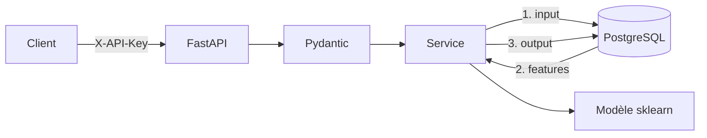

# Attrition API : prédiction du risque de départ des employés

[](https://github.com/pierrebrblt/attrition-api/actions/workflows/ci.yml)


Proof of Concept réalisé pour **Futurisys** : mise en production du modèle de Machine Learning
du projet 4 (*Classifiez automatiquement des informations*, données RH de TechNova Partners).
Le modèle estime la probabilité qu'un employé quitte l'entreprise. Il est exposé par une **API
FastAPI** sécurisée, chaque échange est **tracé dans PostgreSQL**, l'ensemble est **testé**
(Pytest, couverture 99 %) et livré par un **pipeline CI/CD GitHub Actions**.

## Sommaire

1. [Fonctionnalités](#fonctionnalites)
2. [Architecture](#architecture)
3. [Prérequis](#prerequis)
4. [Installation](#installation)
5. [Utilisation](#utilisation)
6. [Base de données](#base-de-donnees)
7. [Tests](#tests)
8. [CI/CD](#cicd)
9. [Déploiement](#deploiement)
10. [Authentification et sécurité](#authentification-et-securite)
11. [Modèle](#modele)
12. [Structure du dépôt](#structure-du-depot)
13. [Contribuer et versions](#contribuer-et-versions)

La documentation détaillée se trouve dans [`docs/`](docs/) et peut être consultée avec
`mkdocs serve`.

## Fonctionnalités

* `POST /predict`, `/predict/batch`, `/predict/employee/{id}` : prédiction (probabilité + décision) ;
* `GET /predictions`, `/predictions/{id}` : historique des inputs/outputs ;
* `GET /health`, `/model/info` : supervision ;
* validation stricte des données (Pydantic), documentation Swagger sur `/docs` ;
* traçabilité complète en base (y compris les échecs) ;
* authentification par clé d'API, configuration par environnement (dev / test / prod).

## Architecture



FastAPI · Pydantic v2 · scikit-learn · SQLAlchemy 2 · PostgreSQL 16 · Pytest · Docker ·
GitHub Actions. Les choix techniques sont justifiés dans [docs/architecture.md](docs/architecture.md).

## Prérequis

* Python **3.11**
* PostgreSQL 16 (ou Docker pour le lancer : `docker compose up -d db`)
* Git

## Installation

```bash
git clone https://github.com/pierrebrblt/attrition-api.git
cd attrition-api
python3.11 -m venv .venv && source .venv/bin/activate     # Windows : .venv\Scripts\activate
pip install -r requirements-dev.txt                       # requirements.txt seul pour la prod
cp .env.example .env                                      # adapter mots de passe et clés
docker compose up -d db                                   # PostgreSQL local
python -m db.create_db                                    # base + tables
python -m db.load_dataset                                 # 1 470 employés
```

Variables d'environnement (`.env.example`) :

| Variable | Rôle | Défaut |
|---|---|---|
| `APP_ENV` | `dev`, `test` ou `prod` | `dev` |
| `DATABASE_URL` | URL SQLAlchemy PostgreSQL | SQLite local |
| `API_KEYS` | Clés autorisées, séparées par des virgules (obligatoire en prod) | vide |
| `DECISION_THRESHOLD` | Seuil de probabilité pour `prediction = 1` | `0.5` |
| `AUTO_CREATE_TABLES` | Création des tables au démarrage | `true` (`false` en image prod) |
| `MAX_BATCH_SIZE` | Taille maximale d'un batch | `100` |

## Utilisation

```bash
uvicorn app.main:app --reload
# Swagger : http://localhost:8000/docs   ReDoc : http://localhost:8000/redoc
```

```bash
curl -X POST http://localhost:8000/predict \
  -H "X-API-Key: <votre-clé>" -H "Content-Type: application/json" \
  -d '{"revenu_mensuel": 2100, "nombre_experiences_precedentes": 6, "age": 24,
       "note_evaluation_actuelle": 3, "note_evaluation_precedente": 2,
       "satisfaction_employee_equilibre_pro_perso": 1, "distance_domicile_travail": 25,
       "genre": "F", "departement": "Commercial"}'
```

```json
{"request_id": 1, "prediction": 1, "label": "Oui", "probabilite_attrition": 0.9564,
 "model_version": "1.0.0", "created_at": "2026-11-06T10:38:37.261223Z"}
```

Endpoints, schémas, codes d'erreur et autres exemples : [docs/api.md](docs/api.md).

## Base de données

Cinq tables : référentiel (`employees`, `evaluations`, `surveys`) et traçabilité
(`prediction_requests` pour les inputs, `prediction_results` pour les outputs). Le schéma UML,
le dictionnaire des tables et la gestion des droits sont décrits dans
[docs/database.md](docs/database.md).

| Fichier | Rôle |
|---|---|
| `db/create_db.py` | Création de la base et des tables |
| `db/schema.sql` | DDL PostgreSQL équivalent (généré) |
| `db/load_dataset.py` | Insertion du dataset complet |
| `db/roles.sql` | Rôles `attrition_app` / `attrition_reader` (moindre privilège) |
| `db/queries.sql`, `scripts/query_db.py` | Interrogation des données |
| `scripts/predict_employees.py` | Prédictions en lot via la base |
| `data/examples/predictions_examples.{csv,sql}` | Exemples d'inputs/outputs enregistrés |

## Tests

```bash
pytest                                     # SQLite temporaire
TEST_DATABASE_URL=postgresql+psycopg2://…/attrition_test pytest   # PostgreSQL
pytest --cov --cov-report=html:reports/htmlcov
```

138 tests unitaires et fonctionnels (validation, modèle, données, sécurité, endpoints,
traçabilité, scripts, performances du modèle) et **99,6 % de couverture**. Le rapport se trouve
dans [`reports/coverage.txt`](reports/coverage.txt) et la stratégie de test dans
[docs/tests.md](docs/tests.md).

## CI/CD

`.github/workflows/ci.yml` : **lint** (ruff), puis **tests** sur un service PostgreSQL avec
seuil de couverture, puis **docs** (mkdocs --strict), puis **build** de l'image Docker
avec smoke test en mode prod et publication sur GHCR, enfin **déploiement** `dev` (branche
`develop`) ou `prod` (tag `vX.Y.Z`, avec approbation). Les secrets sont gérés par environnement
GitHub. Détails et configuration : [docs/ci_cd.md](docs/ci_cd.md).

## Déploiement

Hugging Face Spaces étant devenu payant, l'API est déployée **localement en conteneurs** :

```bash
cp .env.example .env            # POSTGRES_PASSWORD, API_KEYS
docker compose up -d --build
docker compose run --rm api python -m db.create_db
docker compose run --rm api python -m db.load_dataset
```

Ou `./scripts/deploy.sh`, le même script que la CD. Voir [docs/deployment.md](docs/deployment.md).

## Authentification et sécurité

* En-tête **`X-API-Key`** obligatoire sur les routes de prédiction et d'historique (401 si
  absente, 403 si invalide) ; plusieurs clés possibles pour permettre la rotation.
* En production, l'API refuse de démarrer sans clé forte ou sans PostgreSQL.
* Secrets uniquement dans `.env` (ignoré par Git) ou dans les secrets GitHub ; seule une
  empreinte de la clé est stockée en base.
* Rôles PostgreSQL restreints, ports liés à `127.0.0.1`, conteneur non-root.

Détails : [docs/security.md](docs/security.md).

## Modèle

Régression logistique pondérée (StandardScaler + OneHotEncoder), 9 features, réentraînement
reproductible avec `python -m scripts.train_model`. Sur le jeu de test : **ROC AUC 0,65**
(0,72 en validation croisée), **rappel des départs 0,57**. Les performances sont modestes ;
les limites, les pistes d'amélioration et le protocole de mise à jour sont décrits dans
[docs/model.md](docs/model.md).

## Structure du dépôt

```
app/            API (routes, schémas, sécurité, services, ORM, ML)
db/             création de la base, chargement, rôles, requêtes SQL
scripts/        entraînement, batch, requêtes, export, déploiement
models/         artefact du modèle + metrics.json
data/           dataset source (raw/) et exemples d'inputs/outputs (examples/)
tests/          unit/ et functional/
docs/           documentation MkDocs
reports/        rapport de couverture
.github/        workflow CI/CD, modèle de PR
```

## Contribuer et versions

Branches `feature/*` créées depuis `develop`, PR avec CI verte, commits au format
*Conventional Commits*, versions taguées `vX.Y.Z` sur `main`. Voir
[docs/standards.md](docs/standards.md) et [CHANGELOG.md](CHANGELOG.md).

Auteur : Pierre Barbault, pour Futurisys.
