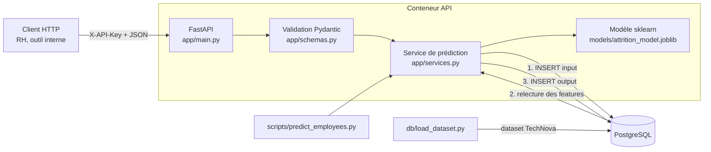

# Architecture



## Organisation du dépôt

```
app/                 code de l'API
  main.py            application FastAPI (routes, dépendances, gestion d'erreurs)
  config.py          configuration par variables d'environnement (dev / test / prod)
  security.py        authentification par clé d'API
  schemas.py         schémas Pydantic (entrées validées, sorties documentées)
  services.py        logique métier : input -> base -> modèle -> base
  database.py        moteur et sessions SQLAlchemy
  db_models.py       modèle de données ORM (5 tables)
  ml/data_prep.py    nettoyage et jointure des 3 CSV (partagé entraînement / base / tests)
  ml/model.py        chargement et inférence du modèle
db/                  création de la base, chargement du dataset, rôles, requêtes SQL
scripts/             entraînement, prédiction en lot, requêtes, export, déploiement
models/              artefact du modèle + métriques (versionnés)
data/raw/            dataset source ; data/examples/ : exemples d'inputs/outputs
tests/unit/          tests unitaires ; tests/functional/ : tests de bout en bout
docs/                cette documentation (MkDocs)
.github/workflows/   pipeline CI/CD
```

## Choix techniques

| Choix | Justification |
|-------|---------------|
| **FastAPI** | Validation native via Pydantic, documentation OpenAPI générée, performances (ASGI). |
| **Pydantic v2** (`Literal`, bornes, `extra="forbid"`) | Le pipeline refuse toute catégorie inconnue (`OneHotEncoder(handle_unknown="error")`) : l'API rejette ces entrées en **422** au lieu de planter en 500. |
| **SQLAlchemy 2 (ORM)** | Schéma défini une seule fois en Python, portable (PostgreSQL en prod, SQLite pour les tests locaux rapides), DDL SQL généré automatiquement. |
| **PostgreSQL 16** | Base relationnelle robuste, contraintes `CHECK`, gestion fine des rôles. |
| **Input écrit avant l'inférence** | Traçabilité complète, y compris des échecs (statut `error`). Le modèle lit ses features depuis la ligne stockée : ce qui est en base est exactement ce que le modèle a vu. |
| **Modèle versionné dans Git** (8 Ko) | La CI teste exactement l'artefact déployé, sans dépendance externe. Au-delà de quelques Mo, passer à Git LFS ou un registre (MLflow). |
| **Versions figées** (`requirements.txt`) | Un modèle sérialisé doit être rechargé avec la même version de scikit-learn. |
| **Docker + docker compose** | Hugging Face Spaces étant devenu payant, le déploiement est local, reproductible et identique à ce que teste la CI. |
| **Fabrique `create_app(settings)`** | Permet d'instancier l'API avec une configuration de test isolée. |
