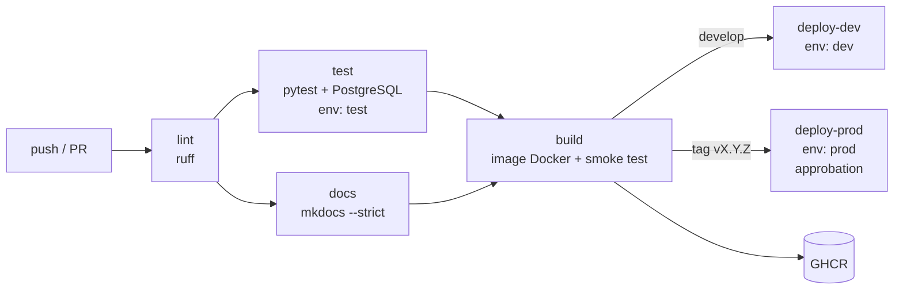

# Pipeline CI/CD

Fichier : `.github/workflows/ci.yml` (GitHub Actions). Durée typique : environ 3 à 4 min.

| Déclencheur | Jobs exécutés |
|---|---|
| push sur `feature/**`, `fix/**`, `docs/**` | lint, test, docs |
| pull request vers `develop` ou `main` | lint, test, docs (**validation avant fusion**) |
| push sur `develop` | + build, publication `:develop`, deploy-dev |
| push sur `main` | + build, publication `:main` |
| tag `vX.Y.Z` | + build, publication `:X.Y.Z` et `:X.Y`, deploy-prod |

## Environnements

| Environnement | Rôle | Configuration |
|---|---|---|
| `dev` | Poste du développeur, et déploiement continu de `develop` | `.env` local ; secrets GitHub `API_KEYS`, `POSTGRES_PASSWORD` |
| `test` | Exécution des tests en CI | Service PostgreSQL éphémère ; secret optionnel `TEST_DB_PASSWORD` |
| `prod` | Version taguée | `APP_ENV=prod` : clés ≥ 16 caractères et PostgreSQL obligatoires, tables créées par script ; reviewers requis |

`APP_ENV` modifie le comportement de l'application (`app/config.py`) : en `prod`, l'API
refuse de démarrer sans clé d'API ou avec SQLite.

## Gestion des secrets

* Aucun secret dans le dépôt : `.env` est ignoré par Git, et `.env.example` ne contient que des valeurs factices.
* Les secrets sont déclarés par environnement GitHub (*Settings → Environments*) et injectés
  en variables d'environnement. GitHub les masque dans les logs.
* Le smoke test génère des secrets éphémères (`openssl rand`) masqués avec `::add-mask::`.
* La publication sur GHCR utilise le `GITHUB_TOKEN` éphémère (permission `packages: write`
  limitée au job `build`).

## Déploiement

Hugging Face Spaces étant devenu payant, le déploiement cible une **machine locale** :

* le job `build` vérifie que l'image démarre en mode prod (création de la base, chargement,
  `/health`, 401 sans clé, prédiction avec clé), puis la publie sur GHCR ;
* les jobs `deploy-*` s'exécutent sur un **runner GitHub auto-hébergé** (la machine locale) et
  lancent `scripts/deploy.sh` (`docker compose pull` + migrations + health check). Ils
  s'activent avec la variable de dépôt `SELF_HOSTED_DEPLOY=true`.

## Configuration GitHub à faire une fois

1. *Settings → Environments* : créer `test`, `dev`, `prod` ; ajouter `API_KEYS` et
   `POSTGRES_PASSWORD` à `dev` et `prod` ; ajouter des *required reviewers* sur `prod`.
2. *Settings → Branches* : protéger `main` et `develop` (PR obligatoire, checks `Lint (ruff)`,
   `Tests + couverture (PostgreSQL)` et `Documentation (MkDocs)` requis, pas de push direct).
3. (Optionnel) *Settings → Actions → Runners* : enregistrer la machine locale comme runner,
   puis définir la variable `SELF_HOSTED_DEPLOY=true`.
