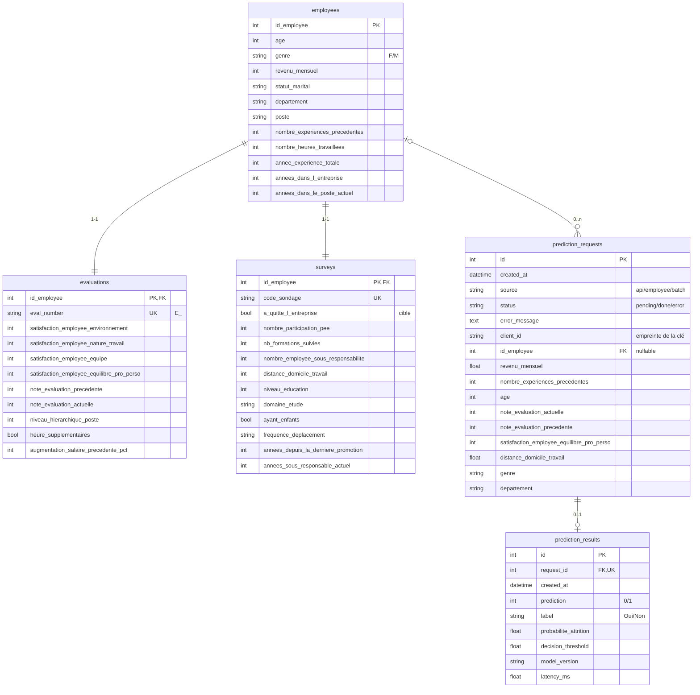

# Base de données

PostgreSQL 16. Le schéma est défini dans `app/db_models.py` (SQLAlchemy). `db/schema.sql` en
est la traduction SQL générée ; un test vérifie que les deux restent synchronisés.

## Schéma (UML / entité-association)



## Tables

**Référentiel** (dataset TechNova, 1 470 employés, chargé par `db/load_dataset.py`) :

* `employees` ← `extrait_sirh.csv`
* `evaluations` ← `extrait_eval.csv` (`eval_number = 'E_<id_employee>'`)
* `surveys` ← `extrait_sondage.csv` (`code_sondage` = id zéro-paddé), contient la cible

Transformations appliquées (`app/ml/data_prep.py`) : `"Oui"/"Non"` et `"Y"/"N"` convertis en
booléens, `"11 %"` converti en `11`, coquilles des noms de colonnes corrigées
(`nombre_heures_travailless`, `augementation_…`, `annes_…`). Le chargement échoue explicitement
si les identifiants des 3 fichiers ne correspondent pas ou si une valeur est inattendue.

**Traçabilité** : chaque appel au modèle crée une ligne `prediction_requests` (input, écrite
**avant** l'inférence), puis une ligne `prediction_results` (output). Les features envoyées au
modèle sont relues depuis la ligne enregistrée. En cas d'échec, la requête est conservée avec
`status = 'error'` et le message d'erreur.

**Volumétrie** : index sur `created_at`, `id_employee`, `departement` et
`a_quitte_l_entreprise` ; insertions groupées pour les batchs ; pagination de l'historique.

## Scripts

```bash
python -m db.create_db                      # crée la base (si absente) et les tables
python -m db.create_db --dump-sql db/schema.sql
python -m db.load_dataset [--replace]       # insère le dataset (idempotent)
psql "$ADMIN_URL" -v app_password="'...'" -v reader_password="'...'" -f db/roles.sql
python -m scripts.predict_employees --limit 100   # prédictions en lot via la base
python -m scripts.query_db stats|employee <id>|history|errors
python -m scripts.export_examples           # -> data/examples/predictions_examples.csv
psql "$DATABASE_URL" -f db/queries.sql      # requêtes SQL d'analyse
```

## Exemples d'entrées en base

* `data/examples/predictions_examples.csv` : 44 inputs/outputs réels (sources `api`, `employee`, `batch`) ;
* `data/examples/predictions_examples.sql` : mêmes données en `INSERT` PostgreSQL.

## Gestion des accès

`db/roles.sql` crée deux rôles selon le principe du moindre privilège :

| Rôle | Référentiel | Traçabilité | DDL |
|------|-------------|-------------|-----|
| `attrition_app` (API) | SELECT | SELECT, INSERT, UPDATE (pas de DELETE) | non |
| `attrition_reader` (analyse) | SELECT | SELECT | non |

Vérifié en local : `attrition_app` reçoit `permission denied` sur `DELETE FROM prediction_requests`
et `must be owner` sur `DROP TABLE`.
