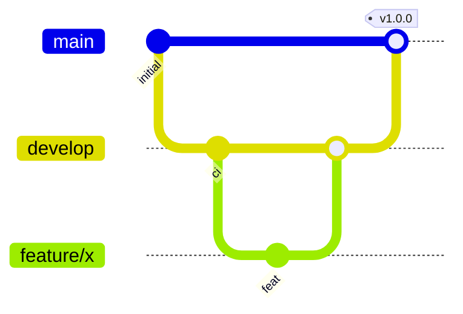

# Standards de code, d'expérimentation ML et workflow Git

## Code

* Python 3.11, dépendances figées (`requirements.txt` pour l'exécution, `requirements-dev.txt` pour le développement).
* Style vérifié par **ruff** (lint + format, ligne de 110 caractères), bloquant en CI.
* Typage des signatures, docstrings en français, aucun secret ni chemin absolu en dur.
* Toute nouvelle fonction ou route est livrée avec ses tests (cas nominal et cas d'erreur).
  La couverture doit rester ≥ 90 %.
* Configuration exclusivement par variables d'environnement (`app/config.py`).

## Expérimentation ML

* Une seule source de préparation des données (`app/ml/data_prep.py`), partagée par
  l'entraînement, la base et l'API : pas d'écart entre entraînement et production.
* Graine fixe (`random_state=42`), split stratifié, validation croisée sur le train
  uniquement, jeu de test jamais utilisé pour le choix des hyperparamètres.
* Chaque entraînement produit `models/metrics.json` : version, date, hyperparamètres,
  empreinte des données, métriques, versions des librairies.
* Versionnage sémantique du modèle : *patch* = réentraînement sur de nouvelles données ;
  *minor* = changement d'algorithme ou d'hyperparamètres à contrat identique ;
  *major* = changement des features (contrat d'API).
* Une version n'est déployable que si elle respecte les seuils de `docs/model.md`.
* Les expérimentations exploratoires (notebooks) restent hors de `app/`. Les gros artefacts
  vont sur Git LFS ou dans un registre de modèles.

## Workflow Git

* `main` : versions publiées uniquement, chacune taguée `vX.Y.Z`.
* `develop` : branche d'intégration.
* Branches de travail créées depuis `develop` : `feature/<sujet>`, `fix/<sujet>`,
  `docs/<sujet>`, `ci/<sujet>`. Fusion par PR (CI verte, revue), en `--no-ff` pour garder
  l'historique des fonctionnalités.
* Messages de commit au format **Conventional Commits** : `feat:`, `fix:`, `test:`, `docs:`,
  `ci:`, `refactor:`, `chore:`.
* Conflits : résolution dans l'éditeur (VS Code, *merge editor*), puis relance des tests avant
  de pousser.
* Historique des versions dans `CHANGELOG.md`.
